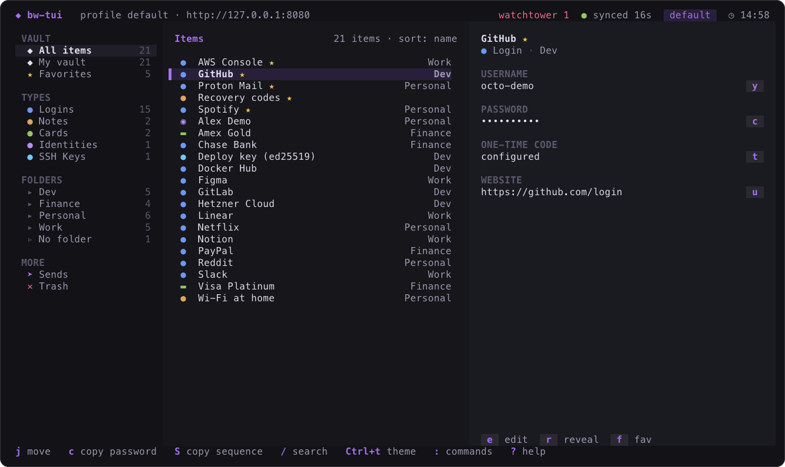
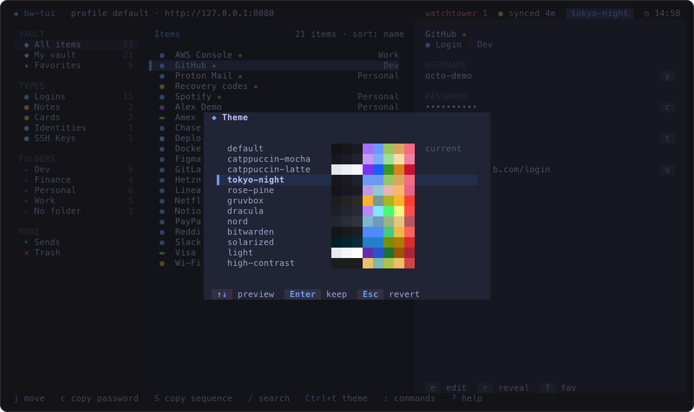
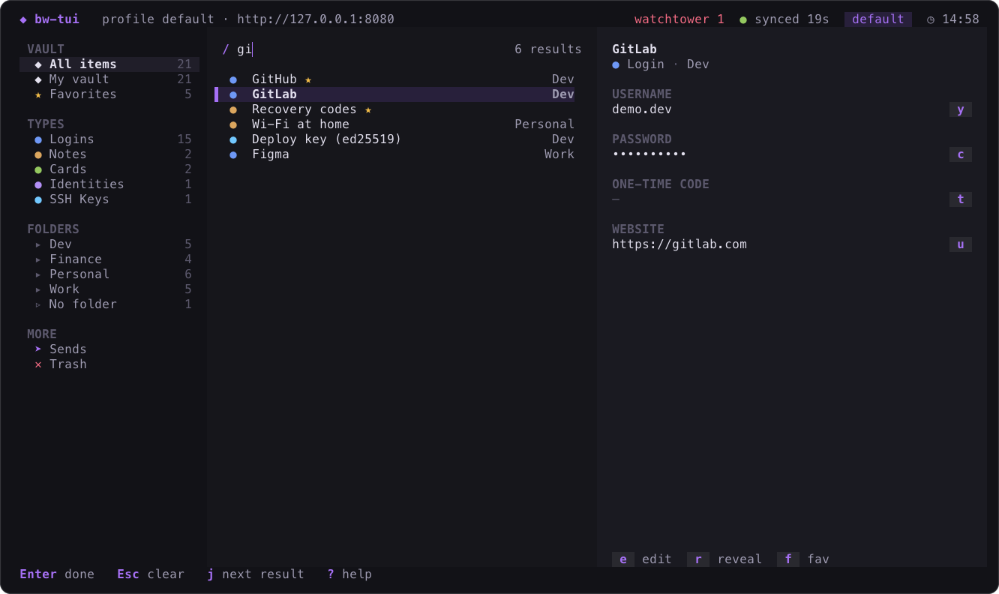
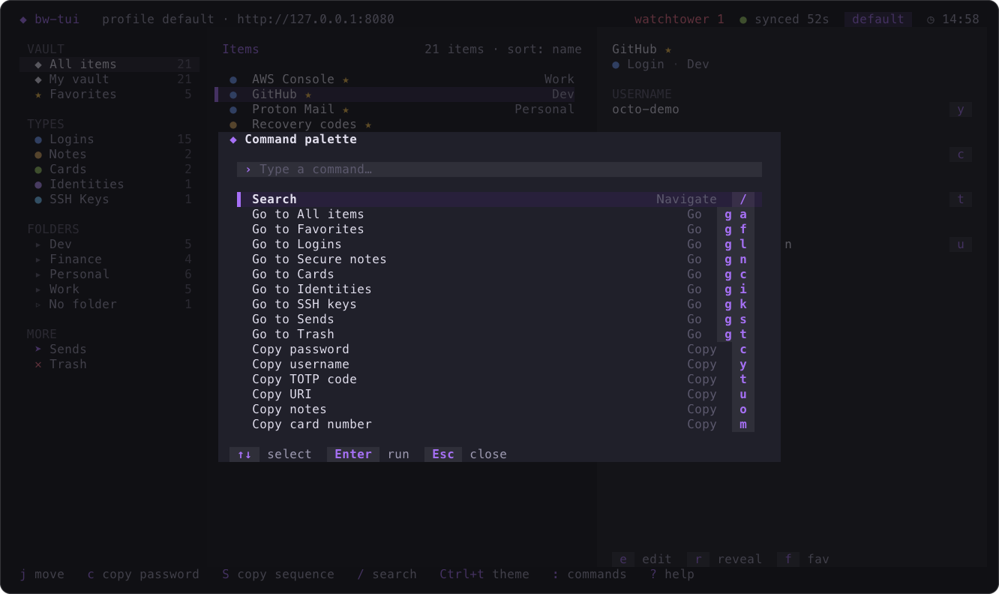
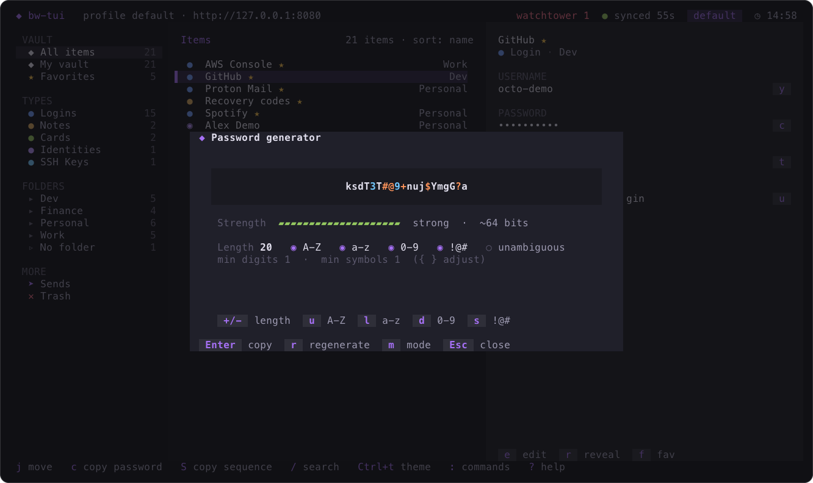
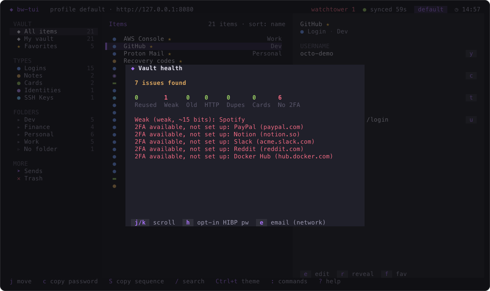
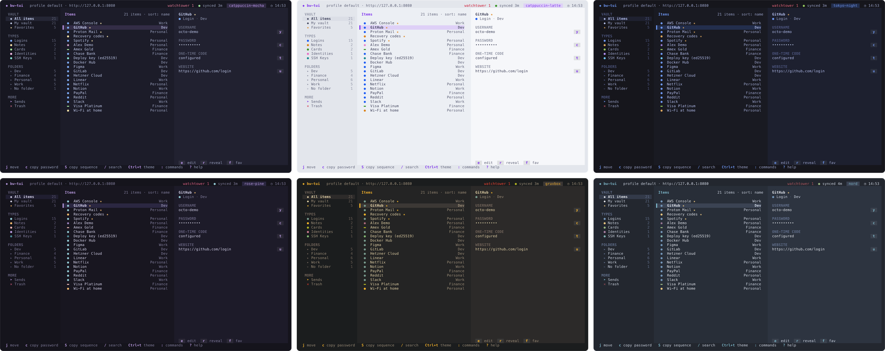

<div align="center">

# bw-tui

**Your Bitwarden vault, in the terminal.**

A fast, keyboard-first password manager client written in Rust<br>
for [Vaultwarden](https://github.com/dani-garcia/vaultwarden) and Bitwarden-compatible servers.

[](https://github.com/everything-tui/bw-tui/releases/latest)
[](#install)
[](https://github.com/everything-tui/bw-tui/releases/latest)
[](LICENSE)

<a href="docs/screenshots/vault.png"></a>
<a href="docs/screenshots/theme-picker.png"></a>

<sub><b>Vault</b>: folders, types and every field one key away &nbsp;·&nbsp; <b>Themes</b>: 12 built in, previewed live</sub>

**[Install](#install)** · **[Quick start](#quick-start)** · **[Tour](#a-quick-tour)** · **[Keys](#keyboard)** · **[Themes](#themes)** · **[CLI](#scripting-cli)** · **[Security](#security-notes)**

</div>

## Why bw-tui

| | |
|---|---|
| ⌨️ **Keyboard first** | Vim-style movement, one key per field to copy, a command palette that lists every action. |
| 🔐 **Every item type** | Logins with TOTP, secure notes, cards, identities, SSH keys, attachments and Sends. |
| 🔎 **Instant search** | Fuzzy search with filters like `type:login`, `folder:work` or `url:github.com`. |
| 🩺 **Vault health** | Finds weak, reused and old passwords, plain-HTTP sites and logins that could use 2FA. |
| 👥 **Profiles** | Several accounts and servers side by side, each with its own auto-lock. |
| 🎨 **Looks the part** | Layered UI, 12 themes with live preview, full color overrides. |
| 🧰 **Scripts too** | A `bw`-style CLI, a background agent, an SSH agent and git / askpass helpers. |
| 📴 **Works offline** | An encrypted cache lets you unlock and copy without a network. |

## Install

**Homebrew** (macOS / Linux):

```bash
brew install everything-tui/tap/bw-tui
```

Update later with `brew upgrade bw-tui`.

<details>
<summary><b>Installer script</b> (Linux, macOS, Windows)</summary>

&nbsp;

Linux / macOS:

```bash
curl --proto '=https' --tlsv1.2 -LsSf https://github.com/everything-tui/bw-tui/releases/latest/download/bw-tui-installer.sh | sh
```

Windows (PowerShell):

```powershell
powershell -ExecutionPolicy Bypass -c "irm https://github.com/everything-tui/bw-tui/releases/latest/download/bw-tui-installer.ps1 | iex"
```

The installers place the `bw-tui` binary on your `PATH` (under `CARGO_HOME` by default).

</details>

<details>
<summary><b>Prebuilt binaries</b></summary>

&nbsp;

Every [GitHub Release](https://github.com/everything-tui/bw-tui/releases) has these archives, each with a `.sha256` checksum:

| Platform | Archive |
|---|---|
| macOS, Apple Silicon | `bw-tui-aarch64-apple-darwin.tar.xz` |
| macOS, Intel | `bw-tui-x86_64-apple-darwin.tar.xz` |
| Linux x86_64 (glibc) | `bw-tui-x86_64-unknown-linux-gnu.tar.xz` |
| Linux arm64 (glibc) | `bw-tui-aarch64-unknown-linux-gnu.tar.xz` |
| Linux x86_64 (static, musl) | `bw-tui-x86_64-unknown-linux-musl.tar.xz` |
| Linux arm64 (static, musl) | `bw-tui-aarch64-unknown-linux-musl.tar.xz` |
| Windows x86_64 | `bw-tui-x86_64-pc-windows-msvc.zip` |
| Windows ARM64 | `bw-tui-aarch64-pc-windows-msvc.zip` |

The musl builds are fully static, so they run on any Linux distribution, including Alpine and old glibc systems. Pick them if the glibc build fails with a `GLIBC_x.y not found` error.

</details>

<details>
<summary><b>Build from source</b></summary>

&nbsp;

Install the stable Rust toolchain from [rustup](https://rustup.rs) and the platform prerequisites:

| Platform | Prerequisites |
|---|---|
| macOS | `xcode-select --install` |
| Debian / Ubuntu | `sudo apt install build-essential pkg-config libssl-dev` |
| Fedora | `sudo dnf install gcc pkgconf-pkg-config openssl-devel` |
| Arch | `sudo pacman -S base-devel openssl` |
| Windows | [Visual Studio Build Tools](https://visualstudio.microsoft.com/visual-cpp-build-tools/) with "Desktop development with C++" |

On Linux, auto-type also needs `xdotool` (X11) or `wtype` (Wayland) at runtime.

Then, from the repository root:

```bash
cargo install --path crates/bw-tui --locked
```

That puts `bw-tui` in `~/.cargo/bin`. For just the binary in `target/release/bw-tui`, run `cargo build --release`.

**Static musl binary (Linux).** OpenSSL is compiled from source automatically, so you need `perl` and `make` but no `libssl-dev`:

```bash
sudo apt install musl-tools perl make
```

```bash
rustup target add x86_64-unknown-linux-musl
```

```bash
cargo build --release --target x86_64-unknown-linux-musl
```

Binary: `target/x86_64-unknown-linux-musl/release/bw-tui`. On arm64, use `aarch64-unknown-linux-musl`.

**Windows ARM64.** Also install the "MSVC ARM64 build tools" component, then run:

```powershell
rustup target add aarch64-pc-windows-msvc
cargo build --release --target aarch64-pc-windows-msvc
```

</details>

<details>
<summary><b>Platform support</b></summary>

&nbsp;

The core TUI (browse, search, edit, copy, Sends) works on every platform. These features depend on the OS:

| Feature | macOS | Linux | Windows |
|---|---|---|---|
| Background agent (stays unlocked between runs) | ✅ | ✅ | ❌ |
| SSH agent integration | ✅ | ✅ | ❌ |
| Lock on system sleep | ✅ | ✅ (needs D-Bus) | ❌ |
| Auto-type | ✅ (`osascript`) | ✅ (`xdotool` / `wtype`) | ❌ |
| Biometric unlock (`biometric` feature) | ✅ | ❌ | ❌ |

</details>

## Quick start

```bash
bw-tui --server https://vault.example.com
```

1. Sign in with your email and master password. Press <kbd>Ctrl</kbd> <kbd>R</kbd> to remember the session.
2. Press <kbd>/</kbd> to search, then <kbd>c</kbd> to copy the password or <kbd>y</kbd> for the username.
3. Press <kbd>:</kbd> for every command, or <kbd>?</kbd> for the full keyboard reference.

## A quick tour

<table>
<tr>
<td width="50%"><a href="docs/screenshots/search.png"></a></td>
<td width="50%"><a href="docs/screenshots/palette.png"></a></td>
</tr>
<tr>
<td align="center"><sub><b>Search</b> filters as you type: <code>type:</code> <code>folder:</code> <code>name:</code> <code>url:</code></sub></td>
<td align="center"><sub><b>Command palette</b> (<kbd>:</kbd>) lists every action with its key</sub></td>
</tr>
<tr>
<td><a href="docs/screenshots/generator.png"></a></td>
<td><a href="docs/screenshots/health.png"></a></td>
</tr>
<tr>
<td align="center"><sub><b>Generator</b> (<kbd>P</kbd>): passwords and passphrases with a strength meter</sub></td>
<td align="center"><sub><b>Vault health</b> (<kbd>R</kbd>): weak, reused and old passwords, missing 2FA</sub></td>
</tr>
</table>

<sub>All screenshots show a demo vault with made-up data.</sub>

## Profiles & servers

Use named profiles (e.g. `work`, `home`) so each account has its own server, email, and remembered session:

```bash
bw-tui --profile work
bw-tui --list-profiles
```

In the TUI, press <kbd>Ctrl</kbd> <kbd>P</kbd> to create, edit, delete, or switch profiles. On the unlock screen, <kbd>Ctrl</kbd> <kbd>O</kbd> signs out of the current profile only (other profiles keep their saved sessions).

By default, switching profiles **keeps unlocked vaults in memory** (parked) so you can switch back without re-entering the master password. Auto-lock timers keep running on parked profiles. Press <kbd>L</kbd> in the profile manager to toggle **lock-on-switch** (when on, leaving a profile locks and drops its session).

Each profile has its own **auto-lock** idle timeout (default **15 minutes**). Press <kbd>e</kbd> in the profile manager to edit name, server URL, email, and auto-lock (`1`–`1440` minutes, or `off` / `0`). The vault status bar shows `lock MM:SS` or `lock off`. Open (parked or active) vaults show an **open** badge in the list.

<details>
<summary><b>Environment variables</b></summary>

&nbsp;

| Variable | Purpose |
| --- | --- |
| `BW_SERVER` | Server base URL |
| `BW_EMAIL` | Account email |
| `BW_PROFILE` | Active profile id |
| `VAULTWARDEN_URL` | Used by E2E scripts (not the CLI); default `http://127.0.0.1:8080` |
| `E2E_EMAIL` / `E2E_PASSWORD` | Integration test credentials |

</details>

<details>
<summary><b>Files on disk</b></summary>

&nbsp;

Under the app data directory (`~/Library/Application Support/com.everything-tui.bw-tui/` on macOS, `~/.local/share/bw-tui/` on Linux):

```text
config.toml                   # theme, generator defaults, background sync interval, keybinding overrides
profiles.json                 # registry + active profile
profiles/<id>/auth.json       # profile auth metadata + cached KDF (refresh token prefers OS keychain)
profiles/<id>/vault.cache     # UserKey-encrypted last sync (offline unlock)
```

Older installs with a flat `login.json` / `auth.json` are migrated once into profile `default`.

</details>

## Keyboard

The vault browser follows a few rules so keys are guessable:

- **Lowercase = frequent, Shift = heavier variant, Ctrl = app-level.** `c` copies, `C` clones; `p` copies the SSH public key, `P` opens the generator.
- **One key, one meaning.** Copy keys work from any pane, and each field in the detail pane shows the key that copies it. `n` / `e` / `d` always mean new / edit / delete *the focused thing* (item, folder, or Send).
- **Enter goes in, Esc goes back.** Enter: folders → items → detail → edit. Esc: leave the pane → clear the search → clear marks.
- **Hints follow you.** The status bar shows the keys that matter for the current pane/view; `:` lists every command with its key; `?` shows the full map.

The ones you'll use every day:

| Key | Action |
| --- | --- |
| <kbd>j</kbd> <kbd>k</kbd> / <kbd>h</kbd> <kbd>l</kbd> | Move / switch pane |
| <kbd>/</kbd> | Search |
| <kbd>c</kbd> <kbd>y</kbd> <kbd>t</kbd> <kbd>u</kbd> | Copy password / username / TOTP / URI |
| <kbd>S</kbd> | Copy sequence: username → password → TOTP |
| <kbd>n</kbd> <kbd>e</kbd> <kbd>d</kbd> | New / edit / delete |
| <kbd>P</kbd> | Password generator |
| <kbd>Ctrl</kbd> <kbd>T</kbd> | Change theme |
| <kbd>:</kbd> | Command palette |
| <kbd>?</kbd> | All keys |

<details>
<summary><b>Full key map</b></summary>

&nbsp;

| Key | Action |
| --- | --- |
| `j` `k` / `↓` `↑` | Move (scrolls when the detail pane is focused) |
| `h` `l` / `←` `→` / `Tab` | Switch pane |
| `Ctrl+d` `Ctrl+u` / `PgDn` `PgUp` | Page |
| `g g` / `G` (also `Home` / `End`) | First / last |
| `g` then `a` `f` `l` `n` `c` `i` `k` `s` `t` | Go to All / Favorites / Logins / Notes / Cards / Identities / SSH keys / Sends / Trash (a popup lists the targets) |
| `/` | Search (`type:login`, `folder:work`, `name:foo`, `url:github.com`, …); `Ctrl+n` / `Ctrl+p` move through results, `Enter` keeps the filter |
| `c` `y` `t` `u` `o` | Copy password / username / TOTP / URI / notes |
| `m` `v` `x` · `p` `b` · `1`–`9` | Copy card number / CVC / expiry · SSH public / private key · custom field |
| `S` | Copy sequence: username → password → TOTP |
| `n` `e` `d` | New / edit / delete (folder when the Folders pane is focused, Send in the Sends view) |
| `f` `r` `Space` | Favorite / reveal secrets (15s) / mark for bulk delete or share |
| `C` `M` `O` | Clone / move to folder / share to organization |
| `U` | Undo last delete |
| `E` `F` `V` `A` `H` `Q` | Notes in `$EDITOR` / custom fields / attachments / upload attachment / password history / QR code |
| `a` `T` | Auto-type login / TOTP into the focused window |
| `s` | Cycle sort: name / recently used / modified |
| `r` `X` (Trash) | Restore / empty trash |
| `c` `o` (Sends) | Copy Send link / open a received Send link |
| `P` `R` `D` `,` | Generator / health report / domain rules / account settings |
| `Ctrl+t` | Change theme (live preview) |
| `Ctrl+s` `Ctrl+l` `Ctrl+n` `Ctrl+p` | Sync / lock / new folder / profiles |
| `:` or `Ctrl+k` | Command palette (every command, with its key) |
| `?` | Help |
| `q` | Quit (press twice while a live vault is unlocked) |

Login: `Ctrl+h` show password · `Ctrl+r` remember · `Ctrl+a` API-key login · `F1` help. Unlock: `Tab` PIN · `Ctrl+o` sign out. Forms: `Tab` fields · `Ctrl+s` save · `Ctrl+g` generate · `Ctrl+e` `$EDITOR` · `Esc` cancel.

</details>

<details>
<summary><b>Rebinding keys</b></summary>

&nbsp;

Vault-browser keys can be changed in `config.toml`. `keys` takes one or more keys separated by spaces, or `none` to unbind. A key you assign is taken away from whichever default had it:

```toml
[[keybindings.overrides]]
action = "open_generator"
keys = "g F2"            # the go-to prefix loses `g`

[[keybindings.overrides]]
action = "quit"
keys = "Ctrl+q"
```

Action names are the snake_case form of the palette entries (`copy_password`, `toggle_favorite`, `goto_prefix`, `receive_send`, …). Conflicts and unknown names are reported as warnings at startup.

</details>

## Themes

<a href="docs/screenshots/themes.png"></a>

<sub><code>catppuccin-mocha</code> · <code>catppuccin-latte</code> · <code>tokyo-night</code> · <code>rose-pine</code> · <code>gruvbox</code> · <code>nord</code></sub>

The interface is drawn in layers rather than boxes. The sidebar, header and status bar sit on the darkest tone, the item list on the middle tone, and the detail pane on the lightest. Popups float on a dimmed backdrop. Every color comes from the active theme.

**Switch live:** press <kbd>Ctrl</kbd> <kbd>T</kbd> (or pick *Change theme* in the `:` palette). Moving through the list previews each theme immediately; <kbd>Enter</kbd> keeps it and saves it to `config.toml`, <kbd>Esc</kbd> reverts.

Built-in themes: `default` (violet), `catppuccin-mocha`, `catppuccin-latte`, `tokyo-night`, `rose-pine`, `gruvbox`, `dracula`, `nord`, `bitwarden`, `solarized`, `light`, `high-contrast`.

```toml
theme = "tokyo-night"
transparent_background = false   # true: let the terminal background show through the panes

[colors]                         # optional: override any token of the chosen theme
accent = "#ff79c6"
surface = "30, 32, 48"           # hex or "r, g, b"
```

<details>
<summary><b>Color tokens</b></summary>

&nbsp;

| Group | Tokens |
| --- | --- |
| Surfaces (back → front) | `mantle`, `base`, `surface`, `overlay`, `backdrop` |
| Text | `text`, `subtext`, `muted` |
| Accent & selection | `accent`, `accent_fg`, `accent_dim`, `select_bg`, `select_bg_idle`, `border`, `border_focused` |
| Status | `danger`, `success`, `warning`, `info`, `favorite` |
| Item types | `login`, `note`, `card`, `identity`, `ssh` |
| Revealed passwords | `digit`, `symbol` |

Overrides and `transparent_background` stay applied when you switch themes. `NO_COLOR` gives a monochrome UI, and `BW_ASCII=1` swaps the Unicode glyphs for ASCII.

</details>

## Scripting CLI

Sign in once via the TUI or `login`, then use subcommands. Prefer the unlock daemon so other commands reuse the session without re-entering the master password:

```bash
bw-tui unlock                                   # prints: export BW_SESSION="…"
bw-tui get "GitHub" --field password
bw-tui --json list --search github --type login
bw-tui totp "GitHub"
bw-tui generate --length 24
```

<details>
<summary><b>All commands</b></summary>

&nbsp;

```bash
# Account / daemon (like BW_SESSION)
bw-tui login --email you@example.com --server https://vault.example.com
bw-tui unlock          # prints: export BW_SESSION="…"
bw-tui lock
bw-tui logout
bw-tui config server https://vault.example.com
bw-tui encode 'hello' # base64 ( --decode reverses )
bw-tui serve --port 8087   # localhost REST API; token printed or BW_SERVE_TOKEN

# Vault
bw-tui --profile work status
bw-tui --json list --search github --type login
bw-tui list --format template --template '{name}\t{username}'   # fzf / rofi friendly
bw-tui get "GitHub" --field password
bw-tui get --uri https://github.com/login --field password
bw-tui create item '{"type":1,"name":"Site","login":{"username":"u","password":"p"}}'
bw-tui edit item Site '{"login":{"password":"new"}}'
bw-tui restore "Old item"
bw-tui move "Site" "Work"
bw-tui share "Site" "My Org" --collection "Shared"
bw-tui totp "GitHub"
bw-tui generate --length 24
bw-tui generate --apply-org-policy   # unlock + clamp to org generator policy
bw-tui sync
bw-tui export backup.json --format json
bw-tui export vault.zip --format zip
bw-tui export encrypted.json --encrypted --password 'export-pass'
bw-tui import backup.json
bw-tui import chrome.csv --format chrome-csv
bw-tui delete "Old item"
# Sends (create/list need an unlocked session; receive needs no login at all):
bw-tui send create "text body" --name Note --password pw --max-access 3 --delete-in 2d --hide-email
bw-tui send create --file ./report.pdf --name Report --expires 12h
bw-tui send list
bw-tui receive 'https://vault.example.com/#/send/<id>/<key>' [--password pw] [-o dir-or-file]
# Shell integration
bw-tui completions zsh > ~/.zfunc/_bw-tui
bw-tui man | mandoc -Tascii | less
# git / SSH helpers (after unlock):
git -c credential.helper='!bw-tui git-credential' clone …
BW_PASSWORD=… bw-tui askpass --prompt 'user@host'
```

Master password is read from stdin (or `BW_PASSWORD` — discouraged). Set `BW_ALLOW_PLAINTEXT_TOKEN=1` only if OS keychain is unavailable and you accept disk-backed refresh tokens.

</details>

In the TUI, open **Account** (<kbd>,</kbd>) to set a PIN for quick unlock, change your master password, or start a profile-local **SSH agent** (Unix; requires `ssh-agent` / `ssh-add` on `PATH`). The agent stops when you lock the vault. Export `SSH_AUTH_SOCK` from the status line message for child shells.

<details>
<summary><b>How syncing works</b></summary>

&nbsp;

While unlocked, the TUI keeps the vault fresh in two layers (`[sync]` in `config.toml`):

- **Revision-date polling** (default every **60** s, `revision_poll_seconds`; `0` disables): `GET /accounts/revision-date` is a tiny request. A full `/sync` only runs when the server revision changed (e.g. you edited from the browser extension), so changes from other devices show up within one poll interval. It never resets the idle auto-lock timer when nothing changed.
- **Periodic full sync** (default every **5** minutes, `background_interval_minutes`): unconditional fallback.

Real-time SignalR/WebSocket push (`/notifications/hub`, MessagePack framing) is **not implemented**; revision polling is the supported live-update path. Manual sync (`Ctrl+s`, CLI `sync`) is always a full sync.

</details>

## Security notes

- Master passwords and decrypted secrets stay in process memory only for the session; quit the app when finished.
- “Remember” stores the profile’s server URL and email in `profiles.json`, plus auth metadata in `profiles/<id>/auth.json`. The refresh token is stored in the **OS secure store** (macOS Keychain / Windows Credential Manager / Linux Secret Service) when available, with a plaintext disk fallback if secure storage fails—same model as the official Bitwarden desktop client. The master password is never written to disk.
- After a successful sync, the encrypted vault payload is cached in `profiles/<id>/vault.cache` (ciphertext only; encrypted with your UserKey). On later unlocks without network, the app can decrypt that last synced state with your master password. Offline mode is **read-only** (browse/copy); create/edit/delete/favorite require connectivity. Sign-out deletes the cache.
- Prefer HTTPS and a trusted Vaultwarden instance in production. The Docker Compose stack is **dev/test only** (`SIGNUPS_ALLOWED=true`, fixed `ADMIN_TOKEN`).
- Never commit `.env`, admin tokens, or vault data volumes.
- Clipboard copies may linger in the system clipboard; clear them after use if on a shared machine.

See [SECURITY.md](SECURITY.md) to report a vulnerability.

## Development

<details>
<summary><b>Docker test environment</b></summary>

&nbsp;

Local Vaultwarden for development and integration tests:

```bash
# Start Vaultwarden (port 8080)
docker compose -f docker/compose.yml up -d

# Wait until healthy /alive, print test credential hints
./scripts/e2e-setup.sh

# Start (if needed) + run cargo tests
./scripts/e2e-run.sh
```

| Setting | Value |
| --- | --- |
| URL | http://127.0.0.1:8080 |
| Admin token | `dev-only-admin-token` (dev only) |
| Test password | `TestPassword123!` (created dynamically per test run) |

Point the TUI at it with `bw-tui --server http://127.0.0.1:8080`.

**Registration (Vaultwarden ≥1.37):** `POST /identity/accounts/register/send-verification-email` then `POST /identity/accounts/register/finish` with encrypted keys. With SMTP verification off, the JWT is returned directly. Shell signup is impractical; Rust integration tests register via crypto.

Stop / reset:

```bash
docker compose -f docker/compose.yml down
# optional: wipe persisted vault data
docker volume rm bw-tui-vw-data
```

</details>

<details>
<summary><b>Versioning & releases</b></summary>

&nbsp;

The version lives in three places that must always match:

- the top heading of `CHANGELOG.md`: `## [X.Y.Z] - YYYY-MM-DD` (no `## Unreleased`)
- `[workspace.package] version` in `Cargo.toml` (all crates inherit it)
- the `bw-tui` entry in `Cargo.lock` (run `cargo update --workspace` after a bump)

Check them locally:

```bash
scripts/version.sh check
```

Versions stay on `0.x.y`: a fix-only batch bumps the patch, anything with new or changed behavior bumps the minor. Sections are `Added`, `Modified`, `Fixed`, `Removed` (and `Security`).

**Branches**

- `main`: day-to-day work. Every PR runs the `Validate Version` check above.
- `publish`: release branch. A PR into `publish` also fails if the version already has a release or isn't newer than the latest one.

**Cutting a release**

1. Make sure the top CHANGELOG entry and `Cargo.toml` have the new version (`scripts/version.sh check`).
2. Open a PR from `main` into `publish` and merge it.
3. `Create Release` runs on the push to `publish`, validates the version and starts `Release` with tag `vX.Y.Z`. If that version is already released, it does nothing.
4. `Release` (cargo-dist) builds all 8 targets, creates the tag and the GitHub Release with archives, checksums and installers, and pushes the Homebrew formula.
5. `Release notes` then rewrites the release page:
   - title: `X.Y.Z - YYYY-MM-DD`
   - every CHANGELOG entry since the previous release
   - install commands and a downloads table
   - a compare link and a link to the full CHANGELOG

Preview the release page text locally:

```bash
scripts/version.sh body
```

The release workflow (`.github/workflows/release.yml`) is generated by cargo-dist. Change `dist-workspace.toml` and run `dist generate` instead of editing it by hand.

</details>

<details>
<summary><b>Workspace layout</b></summary>

&nbsp;

| Crate | Role |
| --- | --- |
| `vault-crypto` | KDF, AES, key wrapping |
| `vault-api` | HTTP client / models |
| `vault-session` | Session & sync |
| `bw-tui` | Ratatui frontend (`bw-tui` binary) |

</details>

## License

[MIT](LICENSE)
